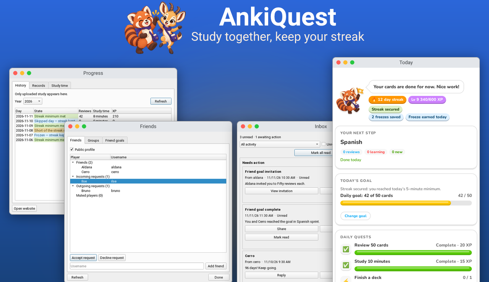

# AnkiQuest

XP, streaks, daily quests, friends and leaderboards for Anki. Clients send review history without card content. Sharing a conquered card label or a deck copy is an explicit choice.

This repository is the AnkiQuest add-on for Anki desktop. AnkiQuest has three repositories:

- [AnkiQuest-Server](https://github.com/AnkiQuest/AnkiQuest-Server): the server, its web pages, the API examples and the shared fixtures.
- [AnkiQuest-Desktop](https://github.com/AnkiQuest/AnkiQuest-Desktop): the Anki desktop add-on.
- [AnkiQuest-Android](https://github.com/AnkiQuest/AnkiQuest-Android): the Android app, an AnkiDroid fork.

The server code still in this repository is being removed; change it in AnkiQuest-Server.

## use it

1. create an account on an AnkiQuest server, such as [ankiquest.rationality-munich.com](https://ankiquest.rationality-munich.com).
2. Connect Anki:
   - **desktop:** in Anki 23.10 or newer (Qt 6), open **Tools → Add-ons → Get Add-ons** and enter **414948448** ([AnkiWeb listing](https://ankiweb.net/shared/info/414948448)). Restart Anki, then choose **Tools → AnkiQuest → Settings → Account**. AnkiWeb manages updates. The [GitHub package](https://github.com/AnkiQuest/AnkiQuest-Desktop/releases/latest) remains available; remove the other installation before switching channels and sign in with the same AnkiQuest account.
   - **Android:** install `AnkiQuest.apk` from the [latest release](https://github.com/AnkiQuest/AnkiQuest-Android/releases/latest). it installs next to AnkiDroid as **AnkiQuest**; sync your collection through AnkiWeb as usual. then open **Settings → ankiquest → Account & connection → Sign in or create account**.
3. study as usual. On desktop, open **Tools → AnkiQuest → Friends** to manage friends and groups, preview a group invitation, or start a friend goal. The website's **Friends** page is also available.

## run your own server

The server lives in [AnkiQuest-Server](https://github.com/AnkiQuest/AnkiQuest-Server).
Follow its [installation and deployment guide](https://github.com/AnkiQuest/AnkiQuest-Server/blob/master/docs/install.md) for prerequisites,
a local build, NixOS with HTTPS, health checks, backups and updates. AnkiQuest
does not replace AnkiWeb or an Anki sync server.

- [Server configuration and administration](https://github.com/AnkiQuest/AnkiQuest-Server/blob/master/docs/server.md)
- [Client API and compatibility](https://github.com/AnkiQuest/AnkiQuest-Server/blob/master/docs/mobile-api.md)
- [Desktop compatibility, tests and packages](docs/desktop.md)

## license

AGPL-3.0-only.

Anki-tan (`static/anki-tan/`) is by [Shigeyuki](https://www.patreon.com/Shigeyuki), from the [Anki-tan asset pack](https://shigeyukey.github.io/shige-addons-wiki/Anki-tan.html), licensed [CC BY-SA 4.0](https://creativecommons.org/licenses/by-sa/4.0/). Derivatives of her art are CC BY-SA 4.0 too.
