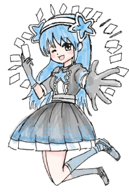
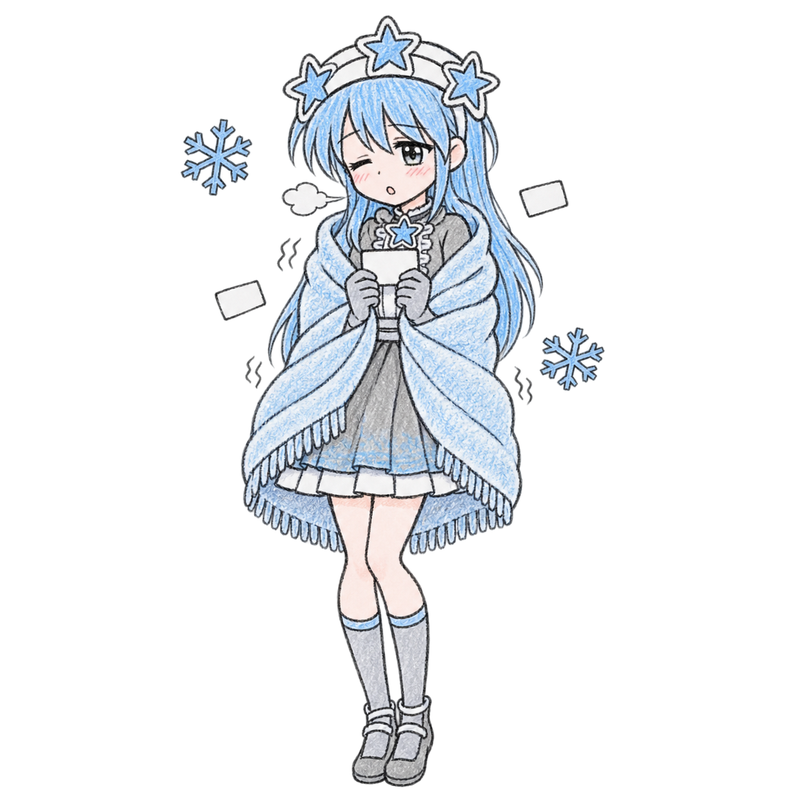
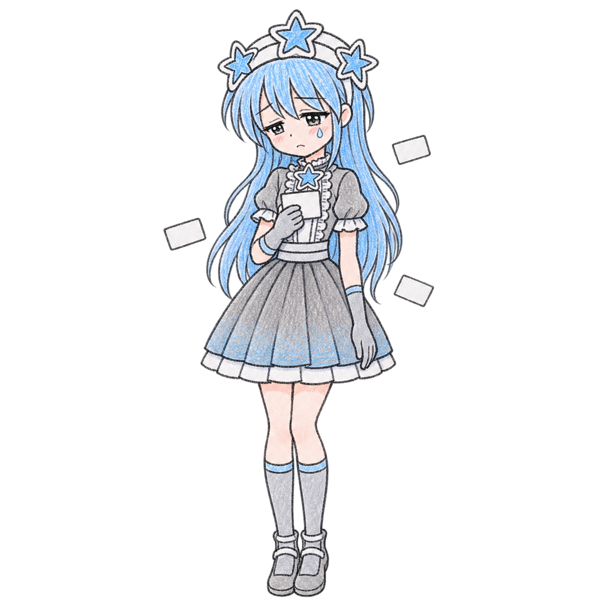

# Full-size Anki-tan additions

Part of [#88](https://github.com/AnkiQuest/AnkiQuest-Desktop/issues/88).
Adds asleep, sad and neglected masters. These supply full-size art where
the imported pack uses chibi faces. Streak is still outstanding. The
other agent owns pose selection and unlock activation.

| Original reference | Existing frozen | Asleep | Sad | Neglected |
|---|---|---|---|---|
|  |  |  |  |  |

The owner approved these three images on 2026-11-16. Three candidates
were generated per pose using OpenAI's `image_gen` tool; its model
identifier was not exposed. Selections: asleep A, sad A, neglected C.
The approved frozen derivative and Shigeyuki's main illustration were
the reference images. [Prompts](generation.json) retain all nine variants.

Each master is 1254 x 1254 RGBA, with no text. The existing
[alpha cleanup](../alpha-cleanup/README.md) clears only pixels with
alpha 1-4. [Measurements](measurements.json) record source/output hashes,
unchanged pixels above alpha 4, and a maximum composite change of 4/255.
The selected art was inspected on white, dark and grey, including 64 px
and 128 px previews. Original art is preserved.

Anki-tan by Shigeyuki (https://www.patreon.com/Shigeyuki).
These derivatives and their exports are licensed CC BY-SA 4.0 under
[her LICENSE](../../../static/anki-tan/LICENSE).

Exports must use `export-addon-art` and `export-android-art`. Linux
exports are canonical. Their review and the linked Android PR are pending.
