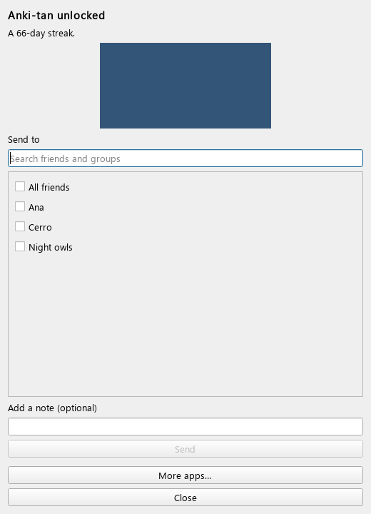
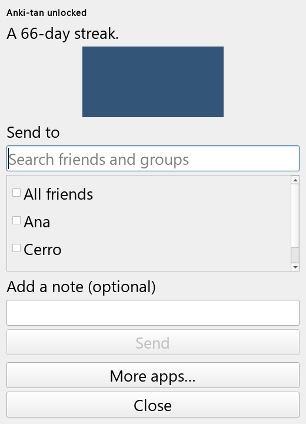

# Desktop moment sharing

On servers advertising `share_moments`, Share and Tell friends open the same
recipient picker. Server wins—including `companion_unlocked`—and conquered
cards can go to all friends, chosen friends and groups, with a 140-character note.
Recent recipients come first. Empty and own-only groups are omitted.

Undo always uses the returned send receipt, even if cached capabilities predate
a server upgrade; older servers ignore the selector.
An old server keeps its previous sharing actions. More apps keeps image export,
text and explicit public-link creation; opening the picker publishes nothing.

The picker belongs to the account and Anki profile that opened it. Closing it,
signing out or switching profiles discards late replies. Changing the moment
behind the picker leaves its selected win and pending reply intact. The editable
conquest deck name remains available before opening the picker.

`tests/fixtures/share_targets.json` defines ordering, selection and Unicode note
cases for both clients. Android consumes them in the #267 parity follow-up.
Existing API examples are exercised by `test_desktop_contract.py`.

The Qt tests cover actual controls, queued requests, account and profile changes,
window closure, independent Undo receipts, legacy servers and both entry points.
The moment-selection and stale-capability Undo regressions failed before their fixes.

These are offscreen Qt captures at normal and enlarged font sizes. The blue
picture is a synthetic image response used to verify preview and export plumbing.
Physical keyboard and screen-reader checks remain unverified.
