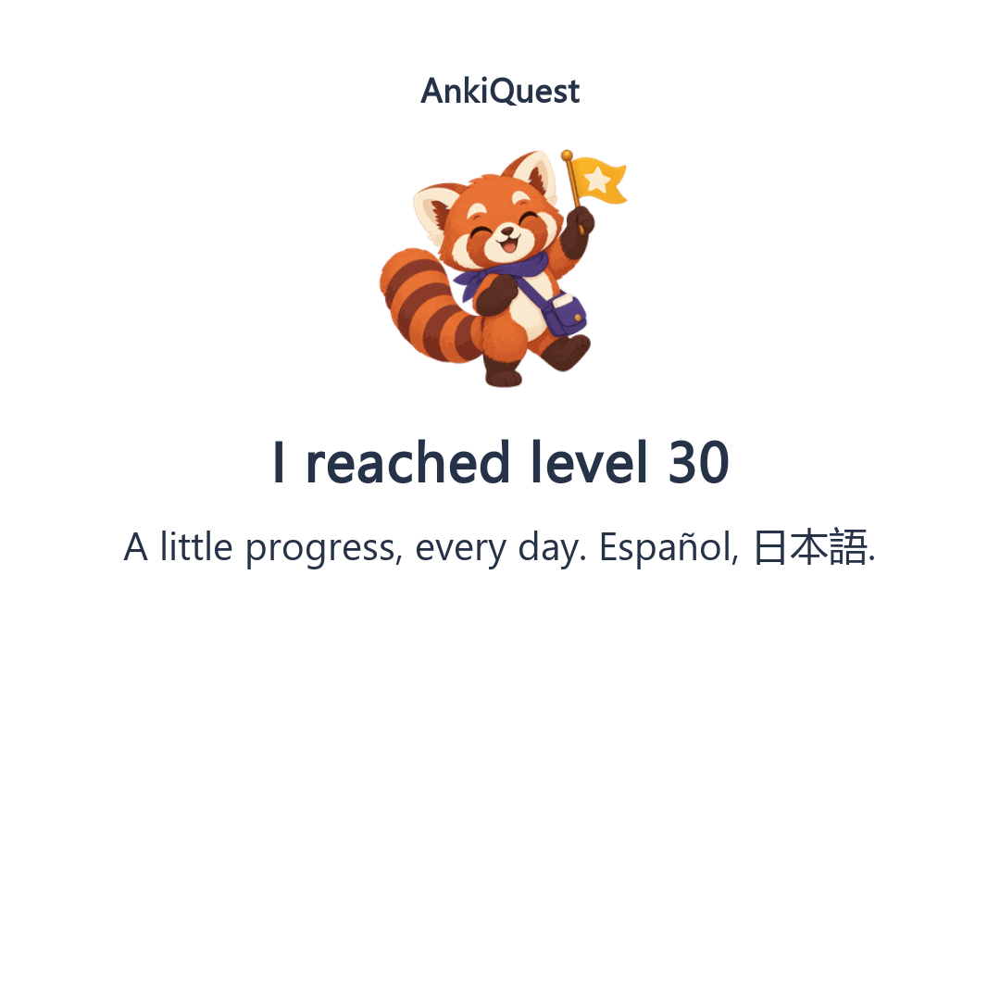
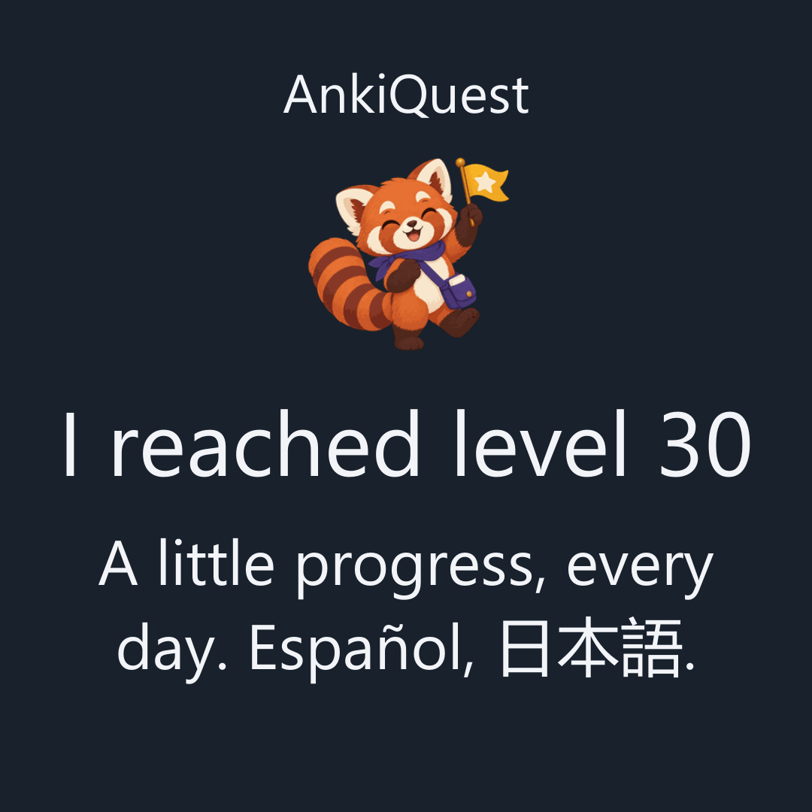
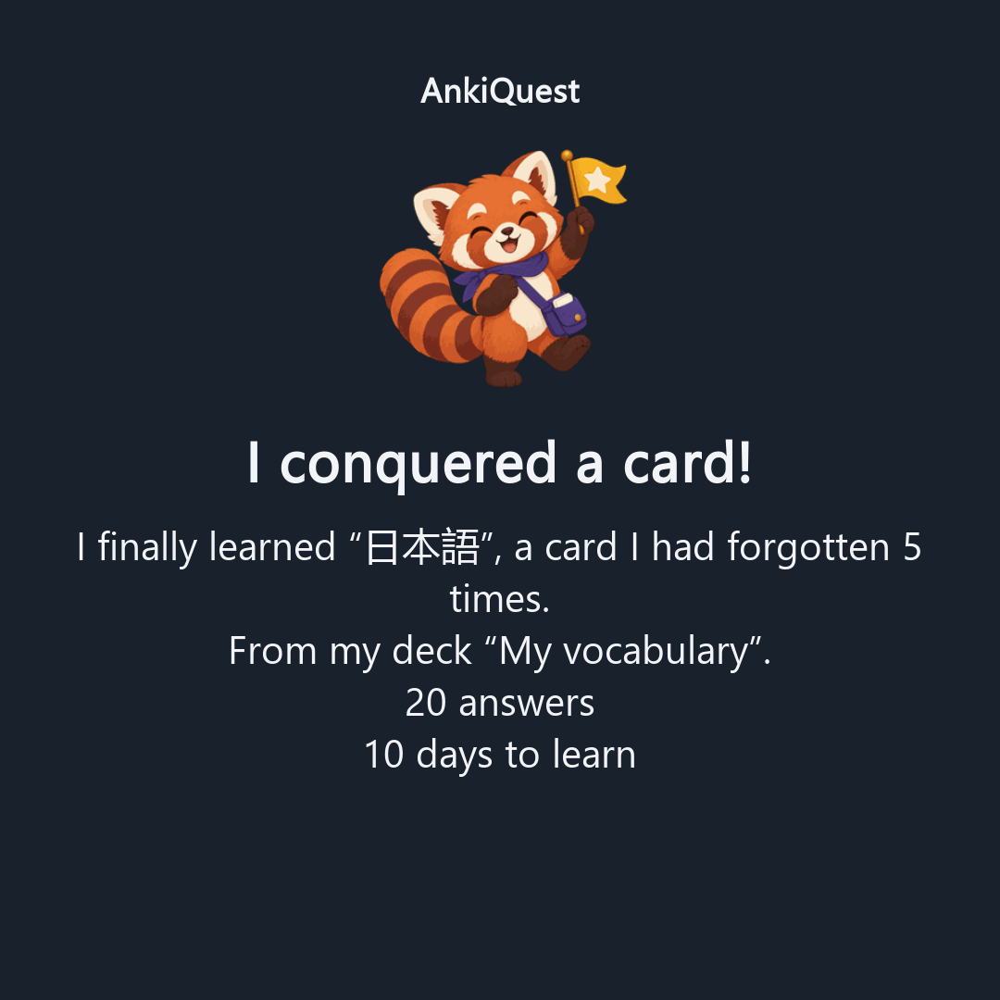
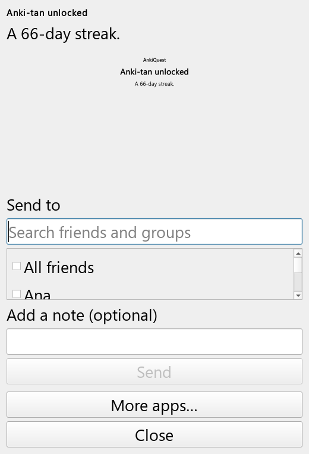

# Offline pictures

Desktop #254, Anki 26.9.4 / Qt 6 on Windows. Captured by the real Qt
sharing tests, with Segoe UI and Japanese font fallback. Server picture
requests fail deliberately. No public link is created.

- `light.png`: local moment picture, normal text.
- `dark-large.png`: dark picture at twice the text size.
- `conquest.png`: saved Japanese label, chosen deck and public counts.
  An extension absent from the add-on uses the companion's happy pose.
- `window-large.png`: the native recipient window with large text and
  the local preview. The list scrolls; Send, More apps and Close stay visible.

The renderer wraps Unicode and long words within 1080 pixels, grows the
picture for longer text and fails explicitly beyond its height limit.
Unsaved labels and hidden fields are never read. A removed label or a
changed account, profile or deck invalidates queued picture work.

